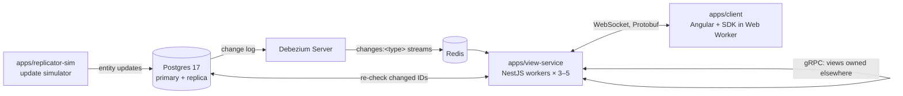

# Atlas realtime: proof of concept

A realtime view service that keeps thousands of browser clients in sync with tens of thousands of constantly changing entities, while each client holds only what is on its screen.

- **Design:** [docs/architecture-plan.md](docs/architecture-plan.md)
- **Research behind the design:** [docs/validation-report.md](docs/validation-report.md)
- **Interfaces between components:** [docs/contracts.md](docs/contracts.md)
- **Work to do, by category:** [docs/tasks/README.md](docs/tasks/README.md)

## How it fits together



## Repository layout

| Path | What | Tasks |
| --- | --- | --- |
| `apps/client` | Angular 22 app (standalone, zoneless) | A-01 – A-05 |
| `apps/view-service` | NestJS workers: streams, views, WebSockets, cluster | S-01 – S-10 |
| `apps/replicator-sim` | CLI scripts: simulate updates and inspect synchronization events | W-03 |
| `packages/protocol` | Protobuf schemas, generated types, outbox event schema | P-01, P-02 |
| `packages/view-engine` | Pure TS: registry, SQL compiler, dependency index, store, tick, hashing | E-01 – E-07 |
| `packages/client-sdk` | Browser SDK running in a Web Worker, map adapter interface | C-01 – C-07 |
| `infra/` | docker-compose: Postgres, Redis + Sentinel + proxy, Debezium | I-01 – I-05 |
| `docs/` | Plan, contracts, tasks | |

## Getting started

Requirements: Node 24 (`.nvmrc`), npm 11, Docker.

```bash
npm ci
npm run build
npm test
npm run infra:up        # start Postgres, Redis, Debezium
npm run postgres:setup  # create Debezium and synchronization objects
npm run postgres:seed   # create commerce tables and initial data
```

Use `npm run replicator:simulate` and `npm run replicator:watch` after setup.
See [infra/README.md](infra/README.md) for the complete workflow.
