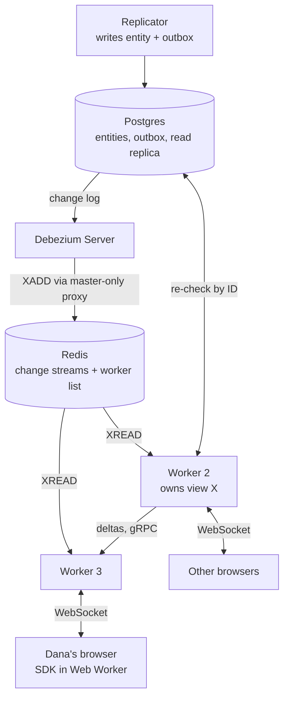

# Realtime View Server Architecture Plan

Oct 20, 2026 · @Jonathan

## Overview

Build one view service that runs as several identical pods (workers). Each worker serves the clients connected to it and owns a share of the views. Postgres runs every query, the replicator's change events say what changed, and each client receives only what is on its screen.

- **Postgres** holds the full entities and does all filtering, joining and nested-data work, through indexed queries.
- **Each view lives on exactly one worker, its owner.** The owner holds only the view's matching IDs plus group and sort values, never whole entities.
- **Clients connect to any worker,** chosen by OpenShift, with no sticky sessions. If a client's worker doesn't own a view the client needs, that worker subscribes to the owner once and passes updates on to all its clients using that view.
- **The client** holds the map fields of matching entities, the rows of the page it shows, and open detail screens.

This follows the pattern Slack and Figma use at much larger scale: connection-holding servers subscribe to the one server that owns each item, chosen by hashing.

Target load: 3,000–5,000 concurrent users, about 1,000 distinct views, fast entity types updating every 5–10 s, end-to-end delay of a few seconds or less.

Four rules keep the design reliable and maintainable:

1. **Postgres is the only source of truth.** Every other component can be wiped and rebuilt from it.
2. **In-memory state exists only while someone uses it.** Each view, page or subscription lives while a user is subscribed, plus a 60 s grace period.
3. **Every upsert carries its source sequence and every event carries `typeSeq`,** so stale updates and duplicates are harmless and stream gaps are detected.
4. **One codebase and one deployment** for the view service. One shared protocol schema generates both server and client types.

Terms used below:

- **Worker**: one pod of the view service. Every worker serves its connected clients and owns a share of the views.
- **View**: one distinct query: entity type + login scope + user filters. Users with the same view share it.
- **Owner**: the one worker responsible for a given view.
- **Login scope**: the countries or connection a user logged in with. It is an ordinary cross-entity filter (see Filters).
- **Layout**: grouping and sort applied on top of a view.
- **Tick**: the interval at which workers process changes, 500 ms to 1 s.
- **Re-check**: running a view's filter against only the IDs that changed.

Changes flow down the right side to the workers, and queries go to the read replica. A client can connect to any worker. Workers subscribe to each other for views they don't own.

## Technology choices

All components are self-hostable. The view service is written in Node (TypeScript), the team's existing stack; Java 21 is the fallback only if load tests show very heavy single views.

| Layer | Choice | Why |
| --- | --- | --- |
| Database | PostgreSQL 16+: a primary, plus one streaming read replica reserved for view workers; Patroni for automatic failover | Joins, JSONB, GIN and trigram indexes for nested and free-text filters |
| Change feed | Redis 7+ Streams, with Redis Sentinel for failover | Already in your stack; messages are stored, ordered and resumable |
| Change relay | Debezium Server: Postgres connector, Outbox Event Router, Redis Streams sink | Off-the-shelf; moves events from Postgres to Redis without loss, with no code to maintain |
| View service (one deployment) | Node.js (TypeScript), many small pods of 1 CPU each | Same language as the client SDK and the team; hashing spreads views across many small pods |
| Client SDK | TypeScript in a Web Worker | No framework or map imports; thin Angular and React wrappers |
| Protocol schema | Protobuf | Generates TypeScript types shared by the client and the view service |
| Map rendering | Cesium primitive collections now; deck.gl if you move to Mapbox or MapLibre | Draws tens of thousands of updating points |
| Load balancer | OpenShift Route and Service (provided, not maintained by developers) | Spreads connections across workers; no sticky sessions |
| Internal calls | gRPC with mutual TLS | Worker-to-worker view subscriptions, encrypted and authenticated in both directions |
| Worker list | Registry in Redis (each worker renews an "I'm alive" entry), behind a small interface | Not tied to OpenShift; OpenShift endpoints or DNS can be swapped in without other changes |
| Orchestration | Kubernetes or your on-prem equivalent | Rolling deploys, health checks, scaling |
| Monitoring | Prometheus, Grafana, OpenTelemetry | Metrics and alerts listed in Observability |

Libraries: pg for Postgres, ioredis for Redis Streams and the worker list, uWebSockets.js for WebSockets, @grpc/grpc-js for worker-to-worker streams, and protobuf-es for the shared schema.

**Why Node.** Node runs JavaScript on one thread per process, so it can't spread one process's work across CPU cores. That doesn't matter here: views are already spread across workers by hashing, so each Node process is simply one more small worker with 1 CPU. Each holds only its share of the views, a few hundred MB, which suits Node. In return the team keeps one language, and the client and server share types and filter-validation code.

Build rules that keep Node fast:

- **uWebSockets.js for WebSockets,** using its built-in topics for fan-out. Publishing to a topic encodes one message once and sends it to every subscriber in native code. Sends triggered from Redis, gRPC or timer callbacks are wrapped in `cork()` so their writes are batched.
- **Sequence numbers on every frame.** uWebSockets.js silently skips a client that is over its send limit during a publish, so the client detects the gap and asks for a snapshot.
- **Compression off for small binary deltas.** Compressing per broadcast roughly doubles CPU (Centrifugo's measurements), and on-prem bandwidth is rarely the limit. Use the shared compressor for large snapshots only.
- **View indexes in typed arrays,** one array per field, not millions of small JS objects. About 2 million entries take roughly 40 MB that the garbage collector doesn't scan. Reposition only changed entries each tick instead of re-sorting.
- **Yield with `setImmediate` between batches of views** within a tick, so sending to clients is never blocked for long. `await` on an already-resolved promise does not let network I/O run. Worker threads add nothing on a 1-CPU pod.
- **Explicit heap settings.** By default Node uses only about half of a 4 GB container. Start with `--max-old-space-size=2560 --max-semi-space-size=32`.
- **Node 22 or 24 LTS.** uWebSockets.js is installed from pinned GitHub release tags, not npm. Mirror it in your internal registry and add a startup check on the Red Hat UBI images, where old system libraries have broken its prebuilt binaries. Have the licence wording reviewed if that matters to your organization.
- **Plan for about 2–3× as many pods** as an equivalent Java deployment.

**When to switch to Java.** Only if the load test shows the slowest single view regularly taking over about 100 ms per tick. One Node process can't split a single view across cores; Java can, and it handles network I/O on separate threads. The design, protocol and data flow stay the same, so only the worker would be rewritten.

## Write path: replicator to Redis Stream

The replicator writes each entity and its change event in the same database transaction. Debezium Server reads the event from Postgres's change log and adds it to Redis, so a committed change always produces an event and there is no relay code to maintain.

1. **Every entity type emits events.** This includes types users never see on the map, such as countries and connections. Any entity a filter can refer to must emit events, or views depending on it go stale.
2. **Source sequence.** Every root entity table stores the source system's globally increasing `sequence bigint`. The replicator copies it in the same transaction whenever any part of the entity changes, including nested child rows. Gaps are normal because Atlas replicates only a subset of source entities. Deletes omit `sequence` from the event and must be applied in source order.
3. **Outbox table,** in Debezium's outbox format.
   - Columns: `id`, `aggregatetype` (entity type), `aggregateid` (entity UUID), `payload jsonb`.
   - The payload holds:
     - source sequence (for upserts) and operation;
     - a sequence number per entity type, increasing by 1 per event, so consumers can spot a lost event;
     - a generic `changes` diff. Inserts carry every business field in `new`;
       updates carry only differing fields in `old` and `new`, including fields
       used for display, filtering and relationships;
     - deletes carry only the entity ID and synchronization metadata. Consumers
       remove that ID directly without evaluating filters.
   - The replicator inserts the row and deletes it in the same transaction. Debezium reads the change log, not the table, so it still sees the insert, and the Outbox Event Router drops the delete. The table stays empty.
4. **Debezium Server settings.** It is an off-the-shelf, self-hostable service configured only through properties:
   - **Postgres connector:**
     - `pgoutput`, with a publication containing only the outbox table;
     - `snapshot.mode=no_data`;
     - `tombstones.on.delete=false`.
   - **Outbox Event Router:**
     - routes each event to the stream `changes:<entity_type>` (`route.topic.replacement=changes:${routedByValue}`);
     - `table.op.invalid.behavior=error`.
   - **Read position:** stored in Postgres (the JDBC offset store), flushed every 1–5 s rather than the 60 s default, so a crash replays seconds of events, not a minute.
   - **Heartbeat:** `heartbeat.interval.ms` with `heartbeat.action.query=SELECT pg_logical_emit_message(false,'heartbeat',now()::varchar)`, so the replication slot keeps advancing when nothing changes.
   - **Redis sink:** `wait.enabled=true` and `wait.retry.enabled=true`. With retry off, a failed replica wait only logs a warning. The sink's replica check misbehaves with 2 or more replicas, so run Redis with one replica or test the setup first. On Redis itself, set min-replicas-to-write 1 and append-only persistence with appendfsync everysec. On the connector, set offset.mismatch.strategy=trust\_offset so a gap after a database failover fails loudly instead of silently.
5. **Debezium needs a stable Redis address.** Its Redis sink does not support Sentinel: after a Redis failover it keeps writing to the old master. Put a small proxy that always points at the current master in front of Redis (for example HAProxy with a role check), and test a failover.
6. **One Debezium instance.** A replication slot serves one reader, so run one pod with the Recreate rollout strategy, a generous shutdown grace period, and the Patroni primary Service as its database address. Delivery is at least once: after a restart it may resend events, which workers ignore by source sequence and `typeSeq`.
7. **Replication slot safety:**
   - **Use Postgres 17 failover slots,** not Patroni's permanent slots. On Postgres 16 those are copied on a timer, and a tested failover lost committed rows. Settings:
     - Debezium `slot.failover=true`;
     - `sync_replication_slots` and `hot_standby_feedback` on standbys;
     - the database name in `primary_conninfo`;
     - `synchronized_standby_slots` on the primary, set through a Patroni callback.
   - **Set `max_slot_wal_keep_size`** to cover the longest Debezium outage you can tolerate. If it is exceeded, Postgres drops the slot and those events are gone for good. Treat that as an incident: every view reloads from Postgres.
   - **Alerts:** retained change log, and Debezium disconnected for more than a few minutes.
8. **Lost events are detected, not assumed impossible.** Redis can lose acknowledged writes during a failover even with replica waits, and Debezium won't resend them. Workers check each stream's per-type sequence number. On a gap, or when a stream looks reset after a failover, they reload affected views from Postgres.
9. **Stream retention:** one designated trimmer per stream runs `XTRIM ... MINID ~` (the approximate form, which is much cheaper) once a minute to drop entries older than 10 minutes. Debezium only appends. A restarted worker rebuilds from Postgres, so the stream only covers brief interruptions (sizing in Cleanup).
10. **Write lockdown.** Only the replicator's database role can INSERT, UPDATE or DELETE entity tables. Any future writer must use the same write-plus-outbox function, or its changes never reach users.
11. **If Redis losses become costly:** NATS JetStream is the natural next step. It has a Debezium Server sink, replicated storage and time-based retention with no trimmer. Kafka or Redpanda only make sense if your organization already runs one.

## View worker internals

Each tick, a worker re-checks only the changed IDs against each affected view it owns and sends the differences. Full queries run only when a view is built, its login scope changes, or it is reconciled.

### Filters

- The client sends a filter as a JSON tree, for example `{"and":[{"field":"airline.name","op":"eq","value":"El Al"},{"field":"runways.count","op":"gte","value":3}]}`. It never sends SQL.
- A per-entity-type **field registry** is the single place filter behavior is defined. For each filterable field it declares:
  - its SQL expression;
  - its allowed operators;
  - the index that serves it;
  - for fields on another entity, how to find the displayed entities linked to a changed one. For example, a changed airport finds airplanes through `airplanes.airport_id`.
- **Login scope uses the same mechanism.** Login by countries compiles to a filter on the entity's country. Login by connection compiles to a join with that connection record. Either way it is part of the view's filter, and changes to countries or connections are handled like any other related entity.
- The worker the user is connected to checks that the user may use the countries or connection before subscribing. The scope comes from the server's own lookup, never from the client.
- The worker compiles the tree to parameterized SQL.
- The tree is normalized (sorted keys, normalized values) and hashed. That hash is the view key, so identical filters share one view.

### State per view

- **Membership map:** ID to source sequence, group values and sort value, about 50 bytes per entity.
- **Per layout:** a group tree with counts, and a sorted index per group that returns any range of positions directly.
- **Subscribing workers,** and a sequence number per view, page and detail subscription.

### Building a view

1. Record the current stream position for each entity type the view reads.
2. Run the full query `SELECT id, sequence, <group fields>, <sort field> WHERE <filters, including scope>`.
3. Fill the membership map and the indexes.
4. Apply all events from the recorded position onward. This is safe because applying an event twice changes nothing.

At most 8 builds run at once per worker; the rest wait in a queue. This protects Postgres when many views move or rebuild at the same time.

### The tick

Every 500 ms to 1 s, per entity type:

1. **Read** new stream events.
   - Check each stream's per-type sequence number. A gap means an event was lost, so reload the views of that type from Postgres.
   - If an ID appears several times, keep only its highest source sequence. Deletes stay ordered by `typeSeq`.
2. **Deletes:** remove the ID from every owned view that holds it. No query is needed.
3. **Candidates:** each view declares the entity fields and relationships it
   depends on. Workers compare those declarations with the keys in
   `changes.old` and `changes.new`; both values are available when a relationship
   moves. Related-entity events use registry-derived link queries to find root
   IDs. Deletes remove the ID from every view that currently holds it.
4. **Replica freshness.** At the start of the tick, read the primary's current change-log position (`pg_current_wal_lsn()`, a cheap call). Every event already read was committed before that position. Wait until the replica's replay position (`pg_last_wal_replay_lsn()`) has reached it, then query.
   - If the replica is more than about 2 s behind, run this tick's queries on the primary.
   - This covers related rows too (an airport, a country), which the per-entity source-sequence check alone cannot.
5. **Re-check, batched:** one query per entity type and tick evaluates every candidate view's filter at once.
   - The query shape is `SELECT id, sequence, (<filter A>) AS a, (<filter B>) AS b, ..., <group and sort fields> FROM <type> WHERE id = ANY($ids)`.
   - Views that share a filter template, differing only in values, pass those values as parameters.
   - A missing row means the entity was deleted.
   - Compiled filter SQL must never throw (for example, guarded casts on JSONB values), because one error would fail the whole batch.
6. **Source-sequence check:** a returned sequence lower than the upsert event's is retried next tick, as a second guard.
7. **Diff:**
   - matches and not in the view: add;
   - doesn't match and in the view: remove;
   - matches and in the view: update, moving it in the group and sort indexes if those values changed.
8. **Related-entity changes** (an airport, a country, a connection):
   - Use the root IDs the replicator put in the event when present. Otherwise use the registry's link, with both the before and after values, so links that changed or chains of links (airplane → airport → country) are caught.
   - A connection change affects every entity in its scope, so those views run their full query and diff the result. These full runs share the build queue and its cap.
9. **Changes during a build:** if a change for an ID arrives while that view's build or full run is still in flight, the result may already be stale. Mark the ID dirty and re-check it next tick.
10. **Send:** one delta per view, page and detail subscription to each subscribing worker, and directly to the owner's own clients.

If a tick takes longer than its interval, the next tick merges the backlog instead of queuing ticks. This is measured and alerted on.

Re-check queries use a pool of about 20 database connections per worker, with `statement_timeout` set to 2 s.

### Pages and detail screens

- **Pages** belong to the view's owner. Users on the same page of the same view and layout share one page subscription (see Pagination).
- **A detail screen** is a view with one extra filter: `id = X` combined with the user's login scope. It reuses all the machinery above, and a user can never open an entity outside their scope by guessing its ID.

### Other rules

- **Relative-time filters** ("updated in the last 5 minutes") can change membership with no event. Either don't offer them, or mark such views for a full re-run every 30 s.
- **One registry, two outputs.** The field registry generates both the SQL compiler and the change-to-view dependency map. A CI test checks that applying random changes incrementally always gives the same result as a full re-run, so a missed link fails the build, not production.
- **Verification.** Two independent checks:
  - **Sampling:** a background check compares a few random views against a fresh full query every minute, as Figma does for LiveGraph.
  - **Reconciliation:** every view re-runs its full query about every 10 minutes, staggered across views.

  Both report and alert on any mismatch, then correct it. Mismatches should be 0; anything else means a bug.
- **Query plans and indexes:**
  - Re-checks look up rows by primary key, so Postgres's cached generic plans are fine for them.
  - Full runs and reconciliation should use custom plans (`plan_cache_mode=force_custom_plan` for those queries), because the best plan depends on the filter values.
  - JSONB filters of the form `data->>'x'` need expression indexes. GIN indexes only help containment (`@>`) queries.
  - If you use PgBouncer, version 1.21 or later supports prepared statements in transaction mode (`max_prepared_statements`).
  - Monitor query cancellations on the replica. Long full runs are the ones at risk. `hot_standby_feedback` reduces cancellations but causes bloat on the primary.
- **Lifecycle:** views, layouts and subscriptions are removed when unused; see Cleanup.
- **Memory cap:** past a worker's limit on views or memory, it evicts idle views first. If it still has no room, it rejects the build and the user's worker reports a retryable error. The scaling alert fires before this happens.

## Cleanup: keeping workers and Redis small

Everything held in memory is either reference-counted back to a connected user or has a time limit. A client that moves between workers never leaves work running behind it.

Reference counting works in two layers:

1. **Each worker** counts its own clients per view, page and detail subscription. When the last local client leaves, it unsubscribes from the owner.
2. **The owner** counts subscribing workers per item, including itself if it has clients on it. When the count reaches zero, a 60 s timer starts. If nobody resubscribes, the item is deleted and no longer re-checked.

| Item | Removed when | Backstop |
| --- | --- | --- |
| Client subscription | Client unsubscribes, leaves the page or disconnects | Heartbeat timeout of 45 s |
| Worker subscription at an owner | The subscribing worker's last local client for it leaves | The worker-to-worker stream closes (crash or network loss): the owner drops all of that worker's subscriptions |
| Page or detail subscription | No subscribers for 60 s | Removed with its view |
| Layout (group and sort index) | No page subscriptions for 60 s | Removed with its view |
| View | No subscribers for 60 s | Over the memory cap, idle views are evicted oldest first |
| Duplicate view after an ownership change | The old owner's copy has no subscribers for 60 s | Same as any view |
| Cached full rows | Their page subscription ends | Size-limited cache |
| Worker list entry in Redis | Its worker stops renewing it; it expires after 10 s | None needed |
| Redis stream entries | Older than 10 minutes; one designated trimmer per stream, once a minute (`XTRIM` with `MINID`) | `MAXLEN` cap per stream |
| Outbox rows | Deleted in the same transaction that inserts them; Debezium reads them from the change log | Alert on replication slot lag |

The 60 s grace period keeps a view alive through a reconnect, a client switching workers, or a user toggling a filter off and on, without a rebuild.

Why 10 minutes of stream history is enough:

- A restarted worker has lost its memory and rebuilds every view from Postgres. It never replays old events.
- So the stream only covers short interruptions of a running worker, such as a Redis reconnect.
- Rough size, by my calculation: a fast type with 30,000 entities updating every 5 s produces 6,000 events/s. At about 300 bytes each, 10 minutes is about 1 GB in Redis. Two hours would be about 13 GB.
- Plain `XREAD` without consumer groups leaves no per-consumer pending lists in Redis that could grow.

## Client protocol and subscriptions

One WebSocket per browser tab, to any worker, carries three kinds of subscription: the map, list pages and detail screens. Each has its own sequence number, so a gap is detected and repaired with a fresh snapshot.

| Direction | Message | Purpose |
| --- | --- | --- |
| Client to server | `auth` | Token on connect, and a refreshed token before expiry |
| Client to server | `openView` / `closeView` | Entity type + filter tree |
| Client to server | `setLayout` | Grouping and sort for a view |
| Client to server | `subscribeMap` | Map fields for every matching entity |
| Client to server | `setWindow` | Group path + row range, for example rows 150–300 |
| Client to server | `openDetail` / `closeDetail` | One entity's full record |
| Client to server | `resync` | Asks for a fresh snapshot after a gap |
| Server to client | `snapshot` | Full state of one subscription, with its `seq` |
| Server to client | `delta` | Adds, updates, removes and group counts since the last `seq` |
| Server to client | `reconnect` | Asks the client to reconnect after a delay (used during deploys) |
| Server to client | `error` | Invalid filter, limit reached, auth failure |

Rules:

- **Batching:** at most one message per subscription per tick.
- **Data sources:**
  - changed map fields come from `changes.new`; unchanged values remain in the
    worker's existing state, and inserts contain the complete business row;
  - window rows and detail come from the read replica by primary key, with the same source-sequence check as re-checks.
- **Ordering:** the client applies a message only if its `seq` is exactly the last one plus 1. Otherwise it sends `resync`.
- **Reconnect:**
  - the client retries with jittered backoff from 1 s up to 30 s, then reopens its views;
  - the server sends fresh snapshots, with no replay of missed deltas;
  - views are usually still in memory, so this is cheap.
- **Slow clients:** each connection has a send buffer cap of about 1 MB. Queued data sits outside the JavaScript heap, so 4 MB across about 1,500 sockets could exceed the pod's memory. Past it, the worker drops that subscription's queued deltas, marks it stale, and sends a snapshot once the buffer drains.
- **Heartbeat:** the worker pings automatically (uWebSockets.js idleTimeout of 16 s) and closes a connection that stops answering. The load balancer's idle timeout must be over 60 s.
- **Auth:** an OIDC token is checked on connect, and the connection closes when the token expires. If the user loses access to their countries or connection, the worker closes the affected views. Changes to a connection's contents need no action; views update live.
- **Limits:**
  - views per connection;
  - filter tree size;
  - at least 3 characters for free text;
  - a rate limit on opening views per user.
- **Very large views:** above about 50,000 matching entities, the map subscription switches to viewport mode. The client sends the visible map area, and the server adds an area condition to the filter (PostGIS, or indexed lat/lon columns).
- **Encoding:** start with JSON plus `permessage-deflate` compression. Move to a binary format (MessagePack or Protobuf) if bandwidth or parsing shows up in profiling.

**Any worker, any time.** The client never assumes it is talking to the same worker as before.

- After a reconnect, possibly to a different worker, it reopens all its subscriptions and receives snapshots.
- The views are usually still alive on their owners, inside their 60 s grace period, so these snapshots are cheap.
- The client sends nothing worker-specific, and a worker keeps nothing about a client after it disconnects.

**Listen first, then load.** When a worker subscribes to a view, it first starts receiving updates, then requests the snapshot, then drops any update whose sequence number the snapshot already covers. A change that arrives while the snapshot loads is never lost. Figma learned the same lesson in LiveGraph.

**Access changes.** Workers read one small stream of access events (which users may use which countries and connections) and close subscriptions the moment access is removed.

## Pagination and live updates

Lists use live server-side pages: the client asks for page N of a list or group, and the server keeps that page current until the user leaves it. The map is never paginated.

- **Request:** `setWindow(viewId, groupPath, page, pageSize)`, for example page 3 at 50 rows. The server replies with the page's rows, the total count and the page count.
- **Computing a page:** the view's owner reads positions 100–149 from its in-memory sorted index. Users on the same page of the same view and layout share one page subscription.
- **Sort key:** always `(sort value, entity ID)`, so ties never swap places between ticks. A sorted array per group is enough at up to 30,000 rows; reposition only changed entries each tick.
- **While the page is open,** each tick the owner sends:
  - the page's ordered list of entity IDs;
  - full data only for IDs the client doesn't have yet or whose data changed;
  - the new total and page count.

  The client rebuilds the page from the ID list and its cache. This is how view servers such as FINOS Vuu and ag-Grid's viewport mode work, and it is simpler and harder to get wrong than sending insert and remove operations.
- **Rows cross page edges.** A new entity sorted onto page 1 pushes the last row of page 1 onto page 2. This is expected with live pages.
- **Calm ordering in the UI:**
  - fixed row heights for virtual scroll;
  - rows and selection tracked by entity ID, never by position;
  - reordering paused while the user hovers or scrolls, with a "N changed — refresh order" banner instead.
- **Page past the end:** if deletions shrink the list below the current page, the server moves the client to the last page and says so.
- **Selected entity moves away:** the detail screen subscribes by ID, so an open entity stays open even if it moves to another page. A `locate(id)` request returns the page it is now on.
- **Fast-changing sort fields** (speed, altitude) move rows between pages every tick. Default sorts should use slow-changing fields such as name or callsign.
- **Groups:** each expanded group pages on its own. A collapsed group costs only its count.
- **Prefetch (optional):** the client also subscribes to the next page so moving forward is instant. It unsubscribes from pages it leaves.

Client memory: one or two pages of full rows per open list.

## Client architecture

All realtime logic lives in one framework-free TypeScript SDK running in a Web Worker. Angular, React, Cesium and Mapbox only touch thin adapters, so switching any of them changes one small layer.

- **SDK in a dedicated Web Worker:**
  - owns the WebSocket connections (one per service), the protocol, sequence checks and reconnects;
  - stores map data per subscription as typed arrays (positions, icon codes, visibility), not as JS objects;
  - holds only the visible page rows and open detail records.
- **To the main thread:** the SDK sends render-ready buffers by transfer (memory handed over without copying), reusing two or three buffers per layer instead of allocating new ones. It sends a frame only when data changed, about 4–10 times per second, not at screen refresh rate. Control calls (subscribe, select, viewport) can use an RPC wrapper such as Comlink; per-tick data uses plain `postMessage`.
- **No SharedArrayBuffer.** It needs cross-origin isolation headers that can block basemap tiles and fonts from other servers.
- **SharedWorker is an optional mode, not the default.** Android Chrome only restored it in April 2026, and it saves only the socket connections, since each tab still needs its own render buffers. The SDK core sits behind an interface so it can run in a dedicated worker, a SharedWorker, or the main thread for tests.
- **Protobuf with protobuf-es,** whose generated code works under a strict Content Security Policy. Positions are sent as packed `bytes` fields so they decode straight into typed arrays.
- **Framework wrappers:** an Angular service exposing signals, and React hooks using `useSyncExternalStore`, each about 50 lines over the SDK's subscribe API. Per-tick map data never enters Angular or React state; the map adapters read the buffers directly. Framework-visible state (counts, page rows) updates at most 2–4 times per second.
- **Map adapter interface:** `createLayer`, `applyFrame`, `pick`, `destroy`. Picking returns entity IDs through a stable slot-to-ID table in the SDK.
  - **Cesium:** try the new experimental `BufferPointCollection`, which stores points in typed arrays and updates them in bulk. Fall back to `PointPrimitiveCollection` or `BillboardCollection`, never the Entity API. Hide with `show = false` rather than removing, use opaque blending where possible, register icons once, and keep positions in double precision.
  - **Mapbox or MapLibre:** deck.gl layers fed the worker's typed arrays directly as binary attributes, through one adapter that covers both basemaps. Not the built-in GeoJSON sources, which re-process data on every update.
  - **Labels** are the likely bottleneck in every engine, so the worker picks a small subset to label (selected, nearby, or by zoom).
  - **Decide early whether points move smoothly between updates.** With updates every 5–10 s, smooth motion needs speed and timestamp fields in the buffer layout.
- **Lists:** a virtual scroll component with fixed row heights. The page request covers the visible rows plus one screen above and below.
- **Hidden tabs:** browsers throttle background timers to once per second, or once per minute after 5 minutes. While hidden, the SDK stops sending frames and keeps only the latest state. On return it re-snapshots every subscription and shows the old data marked stale until fresh data arrives.
- **Testing:** the SDK core takes its clock, random source and transport as inputs, so ordering bugs (sequence gaps, resync, updates before snapshot) are tested deterministically in Node. A mock server speaks the real protocol, injects gaps and generates 30,000-entity load. Recorded traffic is replayed to reproduce field bugs, and the same frames run through every map adapter with visual checks in Playwright.

Client memory then grows with what is on screen: map fields (about 50 bytes per entity) plus about 100–150 full rows.

## Multi-pod deployment without sticky sessions

All workers are identical. Each serves whichever clients OpenShift sends to it and owns a share of the views, chosen by a fixed hashing rule. A client moving between workers therefore causes no duplicate data and no duplicate re-checks.

### Worked example

Dana's browser is connected to worker 3 and opens "French airplanes, El Al".

1. Worker 3 validates the filter and computes the view key.
2. Worker 3 applies the hashing rule to the worker list and finds that worker 2 owns this view. If the rule had pointed to worker 3 itself, it would skip steps 3 and 4.
3. Worker 3 subscribes to the view on worker 2, once, however many of its own clients use the view.
4. Each tick, worker 2 sends one delta for the view to every subscribing worker.
5. Worker 3 passes the delta to Dana and to its other clients on that view.

### The hashing rule (rendezvous hashing)

For a view, every worker in the list gets a score: hash(view key + worker name). The highest score owns the view.

- Every worker holds the same list and runs the same calculation, so all workers agree without talking to each other.
- When a worker joins or leaves, only the views whose top score changes move: about 1/N of views when a worker is added, and only the lost worker's views when one dies.

### The worker list

The list sits behind a small interface ("give me the current workers"), so the design is not tied to OpenShift.

- **Default implementation: a registry in Redis.** Each worker writes its name and address with a 10 s expiry and renews it every 3 s. The list is every entry that hasn't expired.
- **Membership epoch.** A counter in Redis increases on every join or leave, and a change notice is published so every worker re-reads the list at once rather than on its next poll. Every subscribe and update message between workers carries the epoch, so a worker acting on an old list is detected and corrected immediately.
- **Stable worker names.** Workers run as a StatefulSet, so a pod keeps its name across restarts and rollouts. With a normal Deployment every rollout renames every pod, and almost every view would move on each deploy.
- **No flapping.** A worker that drops out and comes back, for example after a long garbage-collection pause, becomes eligible to own views only after it has been present for one full expiry period (10 s).
- A worker adds itself only after its startup steps are done (see Recovery). It removes its entry first when shutting down.
- **Redis hygiene.** Keys are prefixed with the service name (for example `workers:airplanes:*`), and Redis runs with an eviction policy that never evicts these keys.
- **Swappable alternatives:** OpenShift's list of ready pods (detects a dead pod faster, but ties the code to OpenShift), or a DNS lookup of the service name.
- **Why no leader election:** large systems that solve this problem (Slack, Figma, Dapr, Pekko) assign owners by hashing, not by per-item elections or locks. Locks that expire are only safe with extra safeguards, which a read-only view does not need.
- **Custom code is the right call.** The only well-known Node library for this (Uber's ringpop-node) was archived in 2020. The membership and hashing code is about 100–300 lines, covered by a chaos test that kills a pod, pauses one, and fails over Redis.

### Ownership changes

1. A worker sees that a view now has a different owner, from a new list epoch or because its stream to the old owner broke. A broken stream triggers this immediately, without waiting 10 s for the list entry to expire.
2. It subscribes at the new owner, which builds the view. Simultaneous subscribe requests for the same view are merged into one build.
3. It sends its clients a snapshot with a new sequence number.
4. It unsubscribes from the old owner.

While workers briefly see different lists, two workers may hold the same view. Both copies are correct, because each is built from Postgres and the same stream. The unused copy expires after its 60 s grace period. This costs a little temporary duplicate work, never wrong data. If a view ever wrote data instead of only reading it, you would need fencing tokens (an increasing number the storage side checks to reject outdated owners) or a single coordinator, as Slack and Dapr use.

**Between workers:**

- **Bounded queue per subscriber.** Each owner keeps a small queue per subscribing worker. When it fills, the owner drops the queued deltas and sends one fresh snapshot when the subscriber catches up, instead of buffering without limit.
- **Explicit gRPC keepalives** on both sides, roughly a 10 s ping interval and a 5 s timeout. The library defaults find dead peers only after minutes.

### Deploys and scaling

- **Planned stop (handover before the pod disappears):**
  1. On SIGTERM, the worker reports not-ready and removes itself from the worker list. The router stops sending it new connections.
  2. Other workers subscribe at the new owners and receive snapshots while the old owner is still serving ("make before break").
  3. The worker sends each client `reconnect` with a random delay of 0–15 s and closes sockets in batches.
  4. It exits after the drain. Use `terminationGracePeriodSeconds` of about 60 s and a short preStop sleep.
- **Rolling deploy:**
  - one worker at a time (`maxUnavailable: 0`, `maxSurge: 1`, or the StatefulSet equivalent);
  - a new worker reports ready only after it has caught up with the streams;
  - the next worker restarts only when the build queues are empty.
- **Rebuild limits:** at most 8 builds at once per worker, with simultaneous requests for the same view merged, so a deploy or crash never floods Postgres.
- **Scale out when:** memory is over 70% of the limit, tick time is over 50% of the interval, or connections pass the tested limit.
- **If deploys prove disruptive later:** run the same code as two deployments, one holding client connections and one owning views. Then deploying one doesn't disturb the other. Figma made this split for that reason. It needs no code changes, only a setting.

### A very popular view

It lives on one worker, but its cost there is one re-check per tick regardless of how many users watch it. Sending to clients is spread across all workers that subscribe. The only real risk is a single very expensive query, which the per-view timing metric shows.

## Multiple services and scaling limits

Each entity domain gets its own view service with 3 to 5 workers. All services are built from one shared view-engine package and share one Redis.

### One engine, many services

- **Shared package in the monorepo.** The view engine (filters, ticks, hashing, protocol) is one package. Each service is that package plus configuration: which entity types it owns and their field registries. Every service then behaves the same way, and a fix lands everywhere at once.
- **Separate worker list per service** in Redis (for example `workers:airplanes`), so each service hashes only over its own pods.
- **Each service reads only the streams it needs:** its own entity types, plus every type its filters refer to, such as countries and connections. It never calls another service.
- **Client SDK:** opens one WebSocket per service it uses and hides that behind a single "subscribe to a view" API. The app never needs to know which service handles which entity type.

### Limiting load per worker

- **Autoscaling:** OpenShift's autoscaler runs each service at 3 to 5 workers, driven by memory or entities held per worker.
- **Hard per-worker limit,** as a safety net:
  - **Measure cost, not view count.** A view of 30,000 entities costs about 10× one of 3,000, so the limit is in entities held or memory.
  - **Bounded-load hashing (optional).** Capping each worker at about 1.25× the average load makes the owner depend on current load, so workers disagree more often. Use it only if view costs vary widely, and then have one worker compute the assignments for everyone. With a few hundred views over 3 workers, plain hashing is already close to even, so start without it.
  - **When every worker is at its limit:** evict idle views first, then refuse new builds with a retryable error.
- **A service at 5 workers that is still overloaded:** give its pods more CPU and memory, or split it into smaller services by entity type.

### The shared Redis

One Redis with Sentinel serves every service. My rough estimate of its load:

- **Writes:** a few MB/s from Debezium.
- **Reads:** up to about 50 MB/s at 5 services × 5 workers.
- **Memory:** about 1 GB per fast entity type for 10 minutes of history.

That's comfortable for a single instance.

- **Shared failure:** if Redis is down, updates pause for every service, but nothing is lost. This is the same blast radius as Postgres.
- **When to split:** if Redis CPU, memory or outbound traffic grows, or one busy type slows the others.
  - Move to Redis Cluster. Each stream is one key, so streams spread across nodes on their own, and Debezium's Redis sink supports cluster mode.
  - Or run one Redis per group of services.

## Recovery after crashes and restarts

No component holds data that exists only in its memory. Postgres is the source of truth and Debezium resumes from its stored position, so any component can crash and recover without losing an update.

| Component | What is lost | How it recovers | What users see |
| --- | --- | --- | --- |
| Worker | Its client connections, and the views it owned | Its list entry expires within 10 s. Other workers recompute owners and subscribe at the new owners, which rebuild the views, at most 8 at a time each. Its clients reconnect to other workers | Its clients: a reconnect of a few seconds. Others: affected views show the last data marked stale, then reload |
| Worker returning after a restart | Nothing | Adds itself to the list after its startup steps. Hashing gives it back a share of views through the normal ownership handover | Those views reload once |
| Network loss between two workers | In-flight deltas | Stream keepalives detect it within about 10 s. The subscribing worker marks the view stale, reconnects, and takes a snapshot | Stale marker, then reload |
| Client connection | Nothing on the server side | Jittered reconnect from 1 s up to 30 s to any worker, then resubscribe | Last data stays on screen, marked stale, then a snapshot |
| Debezium Server | Nothing; unread changes stay in Postgres's change log | OpenShift restarts it. It resumes from its read position stored in Postgres and may resend a few events, which workers ignore by source sequence and `typeSeq` | Updates pause for the restart time, then catch up |
| Replicator | Nothing; the entity and its outbox row commit together or not at all | Restarts and resumes polling the third-party sources | Updates pause until it is back |
| Redis (Sentinel failover) | Possibly the last few stream entries and list renewals | Debezium retries until Redis accepts the events. Workers reconnect, re-register, and continue from their last stream ID. A worker whose last ID is gone rebuilds its views | Updates pause for the failover, usually seconds |
| Redis, all data lost | All streams and the worker list | Workers re-register within 3 s and detect that their last stream ID is gone, then rebuild all views. Debezium continues from its read position in Postgres | A brief snapshot reload |
| Postgres read replica | Nothing | Workers switch queries to a second replica, or to the primary at a lower concurrency cap. Alert raised | Slower view builds only |
| Postgres primary (Patroni failover) | Possibly the last writes not yet copied to the new primary | The replicator reconnects and retries. Every view then runs reconciliation early, staggered over a few minutes, to correct anything sent but lost | A few corrected rows after the failover |
| OpenShift router | All client connections through it | Clients reconnect with jitter | A reconnect for everyone, spread over up to 30 s |

**Worker startup order:**

1. Connect to Postgres and Redis.
2. Record the current end of each stream.
3. Add itself to the worker list and report ready to OpenShift. Only then does it receive clients and subscriptions.
4. Build each view as subscriptions arrive, using the steps in View worker internals.

**Detecting a stream gap:** on reconnect, a worker compares its last processed ID with the oldest entry in the stream (`XINFO STREAM`). If its ID is older than the oldest entry, or the stream was recreated, events were missed, and the worker rebuilds all its views.

**Crash loops:** OpenShift restarts with growing delays. If every worker is down, clients keep the last data on screen with a "reconnecting" banner and keep retrying.

**Full cold start:** bring up Postgres, then Redis, then Debezium Server, then the workers. The build cap and reconnect jitter spread the initial load.

## Caveats and solutions

Every known way a view can go stale, leak resources or overload a component has a specific fix below. Reconciliation (row 24) is the final safety net for anything not foreseen.

| # | Risk | What goes wrong | Solution |
| --- | --- | --- | --- |
| 1 | Crash between database commit and publish | The change is saved, but no event is sent | Outbox row in the same transaction; Debezium advances its read position only after Redis confirms |
| 2 | Redis failover loses the newest entries | Redis copies to its replica in the background, so a new primary can miss the last events | Debezium's Redis sink waits for replica confirmation (`wait.enabled`) |
| 3 | Events repeated or out of order | Debezium resends after restarts | Upserts carry the source `sequence` and all events carry `typeSeq`; workers ignore values they have already applied |
| 4 | A write that bypasses the replicator | Views never hear about the change | Only the replicator's database role can write; any future writer must use the outbox function |
| 5 | Read replica lag | A re-check reads old data and misses or wrongly keeps an entity | Wait until the replica has replayed past the tick's change-log position; source-sequence check as a second guard; use the primary if the replica lags over 2 s |
| 6 | Nested child row changes | The root entity looks unchanged | The replicator copies a newer source `sequence` to the root and emits the root ID for any change in the entity |
| 7 | Related-entity changes (airport, country, connection) | Views filtering on them go stale | The registry declares each link; the owner re-checks every linked entity. Every referenced type emits events |
| 8 | Connection edits are expensive | One edit re-runs the full query of every view using it | Runs share the build queue and cap; per-view timing metric; measured in the load test |
| 9 | Client reaches different workers over time | Duplicate views and wasted re-checks | Views are owned by hashing, never by the client's connection |
| 10 | Ownership change (scaling, crash, deploy) | Brief duplicate views; clients need fresh data | Both copies are correct; subscribers send a snapshot; the old copy expires after 60 s |
| 11 | Workers briefly see different worker lists | Two owners for one view for up to about 10 s | Harmless duplicate work that resolves when the lists agree |
| 12 | Worker down longer than stream retention | Missed events are gone from Redis | Gap detection on reconnect; full rebuild of its views |
| 13 | Change arrives while a snapshot loads | The change is lost | Start listening before loading; drop updates the snapshot already covers |
| 14 | Reconnect or deploy storm | Many views rebuild at once and overload Postgres | Jittered reconnects, 0–15 s drain delay, 8 builds per worker at a time, one worker at a time in deploys |
| 15 | Slow client or network | Worker memory grows and delay builds up | 1 MB send cap per client; drop queued deltas and send a snapshot later |
| 16 | Slow subscribing worker | The owner's memory grows | Send cap per worker-to-worker stream; drop queued deltas, resend snapshots when it catches up |
| 17 | Missed message | Client state silently diverges | Per-subscription `seq`; any gap triggers `resync` |
| 18 | Expensive filter (non-indexed field, short free text) | Slow re-checks every tick | Only registry fields with indexes; 3-character minimum for text; `statement_timeout` 2 s; query plans checked in CI |
| 19 | Relative-time filters | Membership changes with no event | Not offered in v1, or a full re-run every 30 s for those views |
| 20 | Fast-changing sort field | Rows jump between pages each tick | Default sorts on slow-changing fields; ID as the final tie-breaker |
| 21 | Very large result (over 50,000) | Client and bandwidth overload | Viewport mode: the owner filters by the visible map area |
| 22 | Memory growth on workers | Worker runs out of memory | Reference counting with a 60 s grace period; per-worker caps; evict idle views first; scale out at 70% |
| 23 | Deploys disturb both connections and views | Every restart drops clients and moves views | Rolling one worker at a time; if still disruptive, split into two deployments of the same code |
| 24 | Unforeseen bugs | Views drift from the database | Full reconciliation every 10 minutes per view; a drift metric with an alert on anything above 0 |
| 25 | Opening an entity outside the user's scope | Data leak through detail screens | A detail screen is a view filtered by ID and the user's scope |
| 26 | Token expiry or lost access | User keeps seeing data they may not see | Close on token expiry; workers read the access stream and close affected views immediately |
| 27 | Tick overrun | Delay grows when work exceeds the interval | Merge the backlog into the next tick; alert when tick time passes 50% of the interval |
| 28 | Debezium Server down | Updates stop, and Postgres keeps unread change log on disk | OpenShift restarts it; alert on replication slot lag; `max_slot_wal_keep_size` caps disk use |
| 29 | Replication slot lost (disk cap reached, or failover without the slot) | Events in the gap never reach Redis | Postgres 17 failover slots; if lost anyway, Debezium starts a new slot and every view runs reconciliation |
| 30 | Redis streams never trimmed | Debezium only appends, so Redis memory grows | One designated trimmer per stream runs an approximate trim of entries older than 10 minutes once a minute |
| 31 | OpenShift router drops idle WebSockets | Silent disconnects | Automatic pings every 16 s; route timeout above 60 s; the route's sticky-session cookie disabled and least-connections balancing, so connections spread evenly after restarts |
| 32 | Bandwidth at peak | Map updates for 5,000 users add up (see Observability) | Send only changed fields; binary encoding; compression; a 1 s map tick |
| 33 | Protocol or schema changes | Old clients or workers break during a rolling deploy | One Protobuf schema; the protocol version is sent in `auth`; every component accepts the current and previous version |
| 34 | Internal traffic tampering | Forged subscriptions or data between workers | Mutual TLS on all worker-to-worker gRPC |
| 35 | Lock-in to OpenShift | Moving platforms requires redesign | The worker list sits behind an interface, with Redis as the default; OpenShift only provides routing and restarts |
| 36 | One Redis shared by all services | A Redis outage pauses every service; one busy entity type can slow the others | Sentinel failover; alerts on Redis CPU, memory and outbound traffic; move to Redis Cluster or split per service group when needed |
| 37 | Uneven load across 3–5 workers | One worker holds more heavy views by chance | Limit by entities held, not view count; bounded-load hashing if needed; autoscale from 3 to 5; split the service beyond that |
| 38 | Debezium can't follow a Redis failover | Its Redis sink has no Sentinel support and keeps writing to the old master | A master-only proxy in front of Redis (for example HAProxy with a role check); failover drill in the proof of concept |
| 39 | Redis loses acknowledged events in a failover | Debezium has already moved on, so the events are never resent and views drift silently | Per-type sequence number in every event; workers reload affected views from Postgres on any gap or stream reset |
| 40 | Change arrives while a re-check or full run is in flight | The query result may already be stale | Mark the ID dirty and re-check it next tick |
| 41 | A missed cross-entity link | A related change never reaches the views it affects | Replicator emits affected root IDs; one registry generates SQL and the dependency map; CI property test; online sampler |
| 42 | Every rollout renames pods | Almost every view moves on each deploy | StatefulSet for stable worker names; membership epoch; make-before-break handover |

## Observability and capacity

Measure end-to-end delay from the change's commit time to the moment a worker sends the delta to a client. That one number shows whether the system meets its target.

| Metric | Alert when |
| --- | --- |
| Commit-to-send delay, p50 and p99 | p99 over 3 s |
| Reconciliation drift count | Any value above 0 |
| Replication slot lag (change log Debezium hasn't read yet) | Over 5 s or 1 GB |
| Stream lag per worker (now minus last processed entry time) | Over 5 s |
| Tick duration versus interval, per worker | Over 50% of the interval |
| Read replica lag | Over 2 s |
| Re-check latency and rate; slowest views by build and re-check time | p99 over 50 ms |
| Views owned, pages and builds queued, per worker | Queue not empty for over 60 s |
| Workers in the list versus ready pods in OpenShift | Mismatch for over 30 s |
| Ownership moves per minute | Sustained moves outside deploys or scaling |
| Client connections, worker-to-worker stream errors, send-cap drops, client resyncs | Sudden increase versus baseline |
| Memory per worker | Over 70% of the limit |
| Stream sequence gaps and full reloads triggered | Any gap outside a known failover |
| Ticks deferred or moved to the primary by replica lag | More than a few per minute |
| Online sampler mismatches | Any value above 0 |
| Event-loop delay p99 and WebSocket buffered bytes per worker | Delay over 100 ms; buffers near the cap |
| Replica query cancellations (pg\_stat\_database\_conflicts) | Any increase |

Capacity estimates. These are my calculations, not measurements; confirm them in the load test.

| Item | Estimate | Basis |
| --- | --- | --- |
| Worker memory for views, all workers together | About 1.5 GB; plan 4 GB per worker with 3 or more workers | 1,000 views × up to 30,000 entities × 50 bytes, doubled for overhead |
| Worker memory for connections | Small, mostly send buffers | Up to 1 MB per slow client at worst, outside the JavaScript heap |
| Re-check queries on the replica | 1,000–2,000 per second, about 1–2 CPU cores | 1,000 views, 1–2 ticks per second, about 1 ms each; no duplication across workers |
| Reconciliation queries | About 2 full queries per second | 1,000 views, each every 10 minutes |
| Map traffic per user | 30–300 KB/s before compression | 3,000–30,000 entities updating every 5–10 s, about 50 bytes each |
| Map traffic, all users | About 150 MB/s before compression | 5,000 users at the low end; the largest capacity risk (caveat 32) |

## Build plan and acceptance tests

Build in seven steps, each usable and testable on its own.

1. **Write path:**
   - add source `sequence` columns;
   - write the outbox in the replicator's transactions;
   - configure Debezium Server and the Redis Streams;
   - lock down database write roles.
2. **Field registry and filter compiler:** the JSON filter tree, cross-entity links including login scope, validation, SQL generation, and query-plan checks in CI.
3. **Single worker, map only:**
   - view build;
   - the tick and re-check loop;
   - map subscriptions;
   - the Protobuf protocol with `seq`, snapshots and resync.
4. **Client SDK and Cesium adapter:** the Web Worker, typed-array map store, Angular wrapper, and the map adapter interface.
5. **Pages, grouping, detail:** layouts, group counts, shared page subscriptions, detail views with scope checks, virtual scroll.
6. **Multiple workers and reliability:**
   - the Redis worker list and rendezvous hashing;
   - worker-to-worker subscriptions with listen-first snapshots;
   - ownership handover;
   - reference counting and cleanup;
   - reconciliation, send caps, heartbeats, graceful shutdown;
   - all metrics and alerts.
7. **Load and failure testing** against production-like data and update rates. This sets worker sizing and shows whether deploys need the two-deployment split.

Acceptance tests (each must pass before production):

- [ ] 5,000 simulated clients across 1,000 distinct views: p99 commit-to-send delay under 3 s
- [ ] Clients reconnecting to random workers all session long: each view exists on one worker, and worker memory stays flat
- [ ] Kill a worker under load: its clients recover within 30 s on other workers, its views move, and Postgres stays under its CPU limit
- [ ] Add and remove workers under load: no wrong data, and drift stays at 0
- [ ] Kill Debezium Server: it restarts, and no event is lost
- [ ] Fail over the Redis primary: no event lost, and the worker list recovers
- [ ] Inject 5 s of replica lag: no view ends up wrong after it clears
- [ ] Stop a worker for longer than stream retention: it rebuilds all views correctly
- [ ] Throttle one client's network: worker memory stays bounded, and the client recovers through a snapshot
- [ ] Change only a child row: parent views update
- [ ] Edit a connection's countries: users on it see entities appear and disappear without reconnecting
- [ ] Remove a user's access to a connection: their views close immediately
- [ ] Open a detail screen for an entity outside the user's scope: refused
- [ ] Rolling deploy of all workers during peak load: no errors beyond brief reconnects and snapshot reloads
- [ ] 24-hour soak test: drift stays at 0, and memory returns to baseline after users leave

* [ ] Postgres switchover under full write load: no outbox event lost (duplicates allowed)
* [ ] Redis Sentinel failover under load: Debezium follows the new master through the proxy, and workers detect any sequence gap and reload automatically
* [ ] Random change sequences in CI: the incremental result always equals a full re-run
* [ ] Batched multi-view re-checks vs one query per view: per-tick database time measured with about 1,000 views
* [ ] One 1-CPU worker with 2 million index entries: tick under 50% of the interval and event-loop delay p99 under 100 ms
* [ ] Map client at 30,000 points: Cesium BufferPointCollection vs PointPrimitiveCollection compared
* [ ] Rolling deploy and a reconnect storm through the real OpenShift router

The full validation report, with sources for every change above, is attached in the conversation as "Realtime view service validation".

## Sources

- [Slack: Real-time Messaging](https://slack.engineering/real-time-messaging/)
- [Figma: Keeping it 100(x) with real-time data at scale (LiveGraph)](https://www.figma.com/blog/livegraph-real-time-data-at-scale/)
- [Meta: Scaling services with Shard Manager](https://engineering.fb.com/2020/08/24/production-engineering/scaling-services-with-shard-manager/)
- [Martin Kleppmann: How to do distributed locking](https://martin.kleppmann.com/2016/02/08/how-to-do-distributed-locking.html)
- [Orleans grain directory](https://learn.microsoft.com/en-us/dotnet/orleans/implementation/grain-directory)
- [Debezium Server documentation](https://debezium.io/documentation/reference/stable/operations/debezium-server.html)
- [Debezium Outbox Event Router](https://debezium.io/documentation/reference/stable/transformations/outbox-event-router.html)
- [Debezium Redis connection source (no Sentinel)](https://github.com/debezium/debezium/blob/main/debezium-storage/debezium-storage-redis/src/main/java/io/debezium/storage/redis/RedisConnection.java)
- [Redis WAIT command](https://redis.io/docs/latest/commands/wait/)
- [dbi-services: Surviving a Patroni failover with logical replication](https://www.dbi-services.com/blog/surviving-a-patroni-failover-with-logical-replication/)
- [Gunnar Morling: Mastering Postgres replication slots](https://morling.dev/blog/mastering-postgres-replication-slots)
- [Hasura: live query execution](https://hasura.io/docs/2.0/subscriptions/postgres/livequery/execution/)
- [Crunchy Data: Postgres 17 B-tree bulk scans](https://www.crunchydata.com/blog/real-world-performance-gains-with-postgres-17-btree-bulk-scans)
- [Crunchy Data: prepared statements in PgBouncer transaction mode](https://www.crunchydata.com/blog/prepared-statements-in-transaction-mode-for-pgbouncer)
- [FINOS Vuu viewports](https://vuu.finos.org/docs/providers_tables_viewports/viewports)
- [uWebSockets guide](https://github.com/uNetworking/uWebSockets/blob/master/misc/READMORE.md)
- [Centrifugo: optimizing WebSocket compression](https://centrifugal.dev/blog/2024/08/19/optimizing-websocket-compression)
- [Red Hat: Node.js memory management in containers](https://developers.redhat.com/articles/2025/10/10/nodejs-20-memory-management-containers)
- [gRPC keepalive guide](https://grpc.io/docs/guides/keepalive/)
- [Cesium BufferPointCollection](https://cesium.com/learn/cesiumjs/ref-doc/BufferPointCollection.html)
- [deck.gl performance guide](https://deck.gl/docs/developer-guide/performance)
- [Buf: protobuf-es performance](https://buf.build/blog/protobuf-es-performance)
